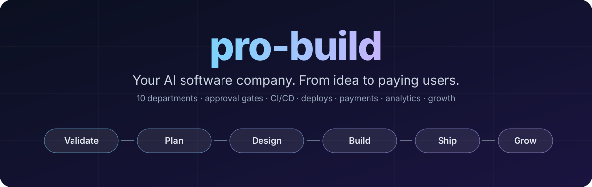
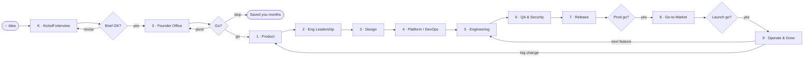

<div align="center">



<br>

[](LICENSE)
[](https://code.claude.com/docs/en/plugins)
[](CHANGELOG.md)
[](https://github.com/affaan-m/ECC)

**Run every project like a real software company.**<br>
Describe your idea. pro-build interviews you until it understands it, writes the docs, builds the MVP, then ships and grows it, with you as CEO approving every gate.

[Quick start](#-quick-start) · [The flow](#-the-flow) · [The company](#-the-company) · [How it works](#-how-it-works) · [Tracks](#-tracks) · [Model routing](#-smart-model-routing) · [Usage](#-usage) · [Toolkit](#-toolkit) · [FAQ](#-faq)

</div>

---

## ✨ Why pro-build?

AI agents can write a lot of code fast. Real products also need everything around the code: checking the idea is worth building, a spec, an architecture, a design system, CI/CD, environments, monitoring, payments, a launch and a growth loop. That missing work is why most AI-built projects never earn a cent.

**pro-build gives Claude Code the structure of a startup.** Each department has a playbook, uses best-in-class tools, produces real artifacts and ends at a gate that only you can approve.

- 🎤 **Understands before it builds.** It interviews you in short rounds (with clickable options) about purpose, goal, users, scope and constraints, then writes a Project Brief for you to approve.
- 🧭 **Validates first.** Founder Office interviews you, researches the market and competitors, and recommends **go, pivot or stop** before any code is written.
- 📐 **Plans like a product team.** A PRD with success metrics, an architecture with decision records, and an independent review of the plan by a second model.
- 🎨 **Designs with taste.** A visual direction and design system that don't look AI-generated.
- 🏭 **Builds the factory first.** Repository, CI, preview, staging and production environments, error monitoring, analytics and payments are wired up *before* the first feature.
- 🧪 **Ships safely.** Test-driven features through pull requests, QA and security gates, staged releases, rollback plans and canary monitoring.
- 💰 **Launches to earn.** Positioning, landing-page conversion, pricing and paywall, SEO, a funnel, lifecycle emails and a live-payments checklist.
- 🧠 **Routes every task to the right model.** Haiku for mechanical work, Sonnet for building, Opus for strategy and security, and Fable (opt-in) for the hardest reviews. Top quality where it matters, fewer tokens everywhere else.
- 📏 **Spec-driven when it matters.** Every plan gets a consistency check (requirement → task traceability), every milestone runs until it converges with the spec, and large features can use [GitHub spec-kit](https://github.com/github/spec-kit) mode.
- 🧯 **Production-grade safety.** One authorization matrix, protected production deploys, approvals tied to an exact build, required QA evidence per release class, real secret scanning with key rotation, tested backups, and an incident runbook.
- 🔬 **Audits what you actually ship.** With [REA](https://github.com/morluto/rea), QA scans your production build for leaked secrets and source maps, Release diffs each build against the last, and Founder Office can study how competitors' public apps work (to learn, never to copy).
- 🔎 **SEO from day one.** Site structure in Design, technical SEO in the scaffold, an SEO and AI-search audit in QA, and a content and ranking engine at launch.
- 📈 **Runs on numbers.** Weekly operating reviews of metrics, revenue and errors, which decide what to build next.
- 🛡️ **Keeps you in charge.** Live payments, production deploys, purchases and publishing always stay with you.

---

## 🚀 Quick start

**1. Install ECC** (required). Inside Claude Code:

```text
/plugin marketplace add affaan-m/ECC
/plugin install ecc@ecc
```

**2. Install pro-build:**

```text
/plugin marketplace add saeedkhoury/pro-build
/plugin install pro-build@pro-build
```

**3. Add the company services you want** (recommended, from the official plugin directory):

```text
/plugin install stripe@claude-plugins-official
/plugin install supabase@claude-plugins-official
/plugin install vercel@claude-plugins-official
/plugin install sentry@claude-plugins-official
/plugin install posthog@claude-plugins-official
/plugin install semgrep@claude-plugins-official
```

**4. Open a new session and found your company:**

```text
/pro-build:pro-build "a SaaS that turns meeting recordings into action items"
```

> [!TIP]
> Services such as Stripe and Vercel need a one-time sign-in through `/mcp`. pro-build tells you when a stage needs one, and works around anything that isn't connected yet.

---

## 🧭 The flow

```text
You:  /pro-build:pro-build "an app that helps gyms manage memberships"

1. Kickoff        → asks 2–4 questions per round: purpose, goal, users, must-haves,
                    platform, business model, data, constraints, references
                  → "Here's what I understood" → a Project Brief you approve
                  → recommends a track (Startup / Product / Client site / Existing)
2. Documents      → validation · PRD · roadmap · architecture · decision records
                    · implementation plan (M1 = MVP) · design system
3. Factory        → repository · README · CLAUDE.md · .env.example · CI/CD
                    · preview / staging / production · monitoring · analytics · payments
4. MVP            → builds milestone M1 test-first, checks it against the spec
                    until nothing is missing ("converged"), then shows you the running app
5. Ship           → QA and security gate → staged release → canary watch
6. Sell and grow  → landing page, pricing, SEO, launch → weekly metrics reviews
```

### Every project gets

| Docs | Engineering | Operations |
|:--|:--|:--|
| Project Brief | `README.md` | `BUILD-STATE.md` (the company's memory) |
| Market validation | `CLAUDE.md` (rules for future AI sessions) | Platform runbook (deploy and rollback) |
| PRD and roadmap | `.env.example` | Launch-readiness report |
| Architecture and decision records | CI workflow and pull-request template | Release notes and `CHANGELOG.md` |
| **Implementation plan (M1 = MVP)** | Test suite | Go-to-market plan |
| Design system | | Weekly operating reviews |

The full list, and which stage creates each file: [`references/project-kit.md`](skills/pro-build/references/project-kit.md).

---

## 🏢 The company

| # | Department | Role | What it delivers | Gate |
|:--:|:--|:--|:--|:--|
| K | **Kickoff** | Discovery lead | Adaptive interview, Project Brief, track recommendation | **Brief approved** |
| 0 | **Founder Office** | Founder advisor | Customer interview, market and competitors, pricing hypothesis, risks, demand test | **Go / pivot / stop** |
| 1 | **Product** | Head of Product | PRD, MVP scope, North Star and input metrics, roadmap and backlog | Spec approved |
| 2 | **Engineering Leadership** | CTO | Stack, data and auth model, decision records, cost estimate, independent plan review, implementation plan | Architecture and plan approved |
| 3 | **Design** | Head of Design | Visual direction, design tokens, components, key screens | Design approved |
| 4 | **Platform / DevOps** | Platform engineer | Repository, README, CLAUDE.md, CI, preview, staging and production, Supabase, Sentry, PostHog, Stripe (test mode) | Pipeline green |
| 5 | **Engineering** | Engineering team | MVP (milestone M1), then test-driven features, one pull request at a time | MVP demo, then each merge |
| 6 | **QA & Security** | QA lead + security officer | End-to-end, browser, accessibility, security, performance, coverage, privacy | No blocking findings |
| 7 | **Release** | Release manager | Versioning, release notes, staging smoke test, rollback plan, canary watch | **Production go** |
| 8 | **Go-to-Market** | Head of Growth | Positioning, landing page, pricing and paywall, SEO, funnel, emails, launch plan, live payments | **Launch go** |
| 9 | **Operate & Grow** | COO / analyst | Weekly metrics, revenue and error review, retro, experiments, roadmap | Next cycle approved |

Each department has its own playbook in [`skills/pro-build/references/departments/`](skills/pro-build/references/departments), which Claude loads only when that stage starts.

---

## 🔄 How it works



Every department ends at a gate: Claude shows the artifacts, the checklist and the risks, then asks you to **approve, revise or stop**.

### CEO briefings

Every gate is presented as a one-minute CEO briefing: **decision needed · what we produced · key numbers · top risks · recommendation · approve / revise / stop.**

### Who may do what

One [authorization matrix](skills/pro-build/references/authorization.md) governs every stage. **A:** the agent may do it (code, tests, pull requests, preview and staging deploys). **B:** the agent may do it only after your specific yes for that exact action, which is logged (merging a pull request, promoting a named build to production, a pre-approved rollback). **C:** only you do it; the agent prepares the steps, waits and verifies (see below). Merges deploy to **staging only**, so nothing reaches production without a release-specific approval.

### What stays with you (the CEO)

pro-build prepares these and explains each one, but never does them for you:

- Switching payments to **live mode** or entering live keys
- The **first production deploy** and production database migrations
- **Buying** domains or plans, and accepting terms
- **Publishing**, posting, emailing customers, app-store submissions and pushing public repositories
- **DNS** changes, **rotating** leaked credentials, and deleting production data
- **Creating accounts** and signing in to services

---

## 🛤️ Tracks

Not every project needs the whole company. Pick a track at the start:

| Track | Best for | Departments |
|:--|:--|:--|
| 🚀 **Startup** | SaaS, apps or marketplaces meant to make money | All, 0 → 9 |
| 🧰 **Product** | Internal tools, portfolio projects, non-commercial apps | 1 → 7, then 9 |
| 🌐 **Client site** | Professional websites for businesses and people | Brief → 1 → 3 → 4 → 5 → 6 → 7 → SEO and conversion |
| 🏗️ **Existing project** | A codebase that already exists | Audit, then join at Engineering or Operate & Grow |

---

## 🧠 Smart model routing

The main conversation (your `/model`) talks with you and runs the gates. Self-contained work is handed to helper agents on the **cheapest model that does it well**:

| Model | Gets | Examples |
|:--|:--|:--|
| ⚡ **Haiku** | Mechanical, low-risk work | Codebase search, summaries, formatting, boilerplate, changelogs, status reports, meta tags |
| 🛠️ **Sonnet** (default) | Building and writing | Features, tests, refactors, CI/CD, PRD drafts, copy, SEO implementation |
| 🧠 **Opus** | Decisions where mistakes are expensive | Strategy, pricing, architecture, security review, hard bugs, risky reviews |
| 💎 **Fable** (opt-in) | The hardest reasoning | Independent plan review, major-release review. Off by default, because it may use paid credits |

Rules: start cheap and escalate one tier on failure; never below Sonnet for payments, auth, security or data migrations; delegate only big chunks (each helper has a start-up cost); and run the main session on Sonnet day to day. That last one is the biggest saving. Full table per department: [`references/model-routing.md`](skills/pro-build/references/model-routing.md).

> [!NOTE]
> Verified in a live test: given a mechanical task, a fresh session handed it to a helper agent, and Claude Code's usage report showed it ran on Haiku.

---

## 📏 Spec-kit mode

For large features, pro-build can hand the feature-level work to [GitHub spec-kit](https://github.com/github/spec-kit), while keeping the company docs, branches and gates:

```text
feat/<name> branch → /speckit-specify (from the PRD) → /speckit-clarify → /speckit-plan (within the architecture)
→ /speckit-tasks → /speckit-analyze → /speckit-implement ⇄ /speckit-converge → pull request → your approval
```

Turn it on during Platform setup (stage 4) if `specify` is installed (`uv tool install specify-cli`). Without it, pro-build runs the same checks natively. Details: [`references/spec-kit.md`](skills/pro-build/references/spec-kit.md).

---

## 🕹️ Usage

| Command | What it does |
|:--|:--|
| `/pro-build:pro-build "<idea>"` | Found a new company project: pick a track, start the first stage |
| `/pro-build:pro-build` | Resume from `BUILD-STATE.md` |
| `/pro-build:pro-build status` | Stage, gates, services, metrics, risks and next step |
| `/pro-build:pro-build stage=<0-9>` | Jump to a department (warns about unapproved gates) |
| `/pro-build:pro-build feature "<what>"` | One Engineering cycle: branch, tests, code, review, pull request |
| `/pro-build:pro-build release` | Staging, smoke tests, rollback plan, production go, canary watch |
| `/pro-build:pro-build launch` | Run Go-to-Market |
| `/pro-build:pro-build review` | The weekly operating review |

Or just ask: *"Let's build this like a real company."*

> [!NOTE]
> Plugin skills are namespaced, so the command is `/pro-build:pro-build`. With the [manual install](#manual-install) it's `/pro-build`.

### Example

```text
> /pro-build:pro-build "a booking app for independent barbers"

Using pro-build v2. Kickoff.

Round 1
  1. Who uses it: solo barbers, shop owners, or both?        [Solo barbers ✓] [Shops] [Both]
  2. What's the main goal in 3 months?                       [Paying users ✓] [Launch] [Portfolio]
  3. Must-have for v1: booking only, or booking + payments?
Round 2
  4. Web app, mobile app, or both?
  5. Any languages besides English?
...
Here's what I understood (Project Brief):
  One-liner: online booking with no-show deposits for solo barbers
  Goal: 20 paying barbers in 3 months · Platform: mobile-first web app
  Must-have: booking page, calendar, deposits, SMS reminders · Later: shop teams
Is this right? → approved

Recommended track: Startup (all departments). Confirm? → yes

Stage 0: Founder Office.
✓ docs/company/00-validation.md
  Competitors: Booksy, Square Appointments, Fresha, plus WhatsApp and pen and paper
  Pricing hypothesis: $19/month per chair, with a free tier up to 30 bookings
  Recommendation: GO, with a narrow wedge (no-show deposits)

Gate 0: go, pivot, or stop?
```

---

## 📒 BUILD-STATE.md and company docs

pro-build keeps the company's memory in your repository:

```text
BUILD-STATE.md                 # track, stage, gates, backlog, services, metrics, risks
docs/company/
  00-validation.md             # problem, market, competitors, pricing, go/no-go
  01-prd.md                    # spec, scope, success metrics, roadmap
  02-architecture.md  adr/     # stack, data model, decisions
  03-design/                   # direction, tokens, components, screens
  04-platform.md               # CI/CD, environments, services, secrets map, runbook
  06-launch-readiness.md       # QA and security report
  07-releases/                 # release notes and rollback plans
  08-gtm.md                    # positioning, pricing, funnel, launch plan
  09-reviews/                  # weekly operating reviews
```

Open any session, run `/pro-build:pro-build`, and it continues exactly where the company left off.

---

## 🧰 Toolkit

pro-build orchestrates other tools; it doesn't reinvent them.

| Layer | Tools |
|:--|:--|
| **Engine** (required) | [ECC](https://github.com/affaan-m/ECC): planning, test-driven development, orchestrated feature workflows, reviews, security, DevOps patterns, SEO, sessions |
| **Payments** | [Stripe](https://github.com/stripe/ai) |
| **Backend** | [Supabase](https://github.com/supabase-community/supabase-plugin) |
| **Deploys** | [Vercel](https://github.com/vercel/vercel-plugin) or [Cloudflare](https://github.com/cloudflare/skills) |
| **Errors** | [Sentry](https://github.com/getsentry/plugin-claude) |
| **Analytics and experiments** | [PostHog](https://github.com/PostHog/ai-plugin) |
| **Security scanning** | [Semgrep](https://github.com/semgrep/mcp-marketplace) |
| **SEO** (optional) | [claude-seo](https://github.com/AgriciDaniel/claude-seo): audits, technical, local, clusters and AI search |
| **Growth** | [marketingskills](https://github.com/coreyhaines31/marketingskills): 53 skills for conversion, pricing, launch, SEO and retention |
| **Design taste** | [taste-skill](https://github.com/Leonxlnx/taste-skill) |
| **Reverse engineering** (optional) | [REA](https://github.com/morluto/rea): competitor teardowns, a release exposure audit of your own build, release diffs, and projects with lost source |
| **Spec-driven features** (optional) | [spec-kit](https://github.com/github/spec-kit) by GitHub: specify → clarify → plan → tasks → analyze → implement → converge |
| **Independent review** | [claudex-loop](https://github.com/chaseai-yt/claudex-loop) (Claude ⇄ Codex) |

Only ECC is required. For anything missing, pro-build names the install command and uses a fallback; see [`references/toolkit.md`](skills/pro-build/references/toolkit.md).

> [!IMPORTANT]
> **Telemetry:** some vendor plugins send anonymous usage data by default. None of them send prompts or code. Turn it off with `VERCEL_PLUGIN_TELEMETRY=off` and `DO_NOT_TRACK=1` (Semgrep). Details are in the [toolkit notes](skills/pro-build/references/toolkit.md#telemetry-notes).

---

## ❓ FAQ

<details>
<summary><strong>Will this make my project earn money?</strong></summary>
<br>
No tool can promise that. What pro-build does is stack the odds: Founder Office tests demand <em>before</em> you build, Go-to-Market sets up the funnel and payments properly, and Operate & Grow measures what's actually happening every week. Many good outcomes are a "stop" at Gate 0 that saves you months.
</details>

<details>
<summary><strong>Isn't this too heavy for a small website?</strong></summary>
<br>
Use the <strong>Client site</strong> or <strong>Product</strong> track. pro-build compresses or skips departments and tells you exactly which ones and why.
</details>

<details>
<summary><strong>Can I use it on an existing project?</strong></summary>
<br>
Yes: choose the <strong>Existing project</strong> track. It audits the codebase, writes <code>BUILD-STATE.md</code>, and joins at Engineering or Operate & Grow.
</details>

<details>
<summary><strong>Do I need accounts for Stripe, Vercel, Sentry and the rest?</strong></summary>
<br>
Only for the services you use. Most have free tiers. pro-build starts everything in test mode and tells you when a sign-in is needed. You always do the sign-in yourself.
</details>

<details>
<summary><strong>Can I customise the departments?</strong></summary>
<br>
Yes. Each department is one readable Markdown playbook. Fork the repo, edit <a href="skills/pro-build/references/departments"><code>references/departments/</code></a> and install your fork.
</details>

---

## 🔧 Install options

### Plugin (recommended)

```text
/plugin marketplace add saeedkhoury/pro-build
/plugin install pro-build@pro-build
```

Update with `/plugin marketplace update pro-build`. Remove with `/plugin uninstall pro-build@pro-build`.

### Manual install

```bash
git clone https://github.com/saeedkhoury/pro-build.git
cd pro-build && ./install.sh
```

This copies the skill to `~/.claude/skills/pro-build`, and the command becomes `/pro-build`. Use the plugin **or** the manual install, not both.

---

## 🤝 Contributing

Ideas, playbook improvements and bug reports are welcome. Please open an issue first. Keep each department in one playbook file, and make sure every skill it names exists in a published plugin.

**Checks before a pull request:**

```bash
python3 evals/check.py                   # structure, references, contradiction rules (also runs in CI)
python3 evals/check.py --refresh-known   # after adding a skill reference (needs the plugins installed)
evals/run-behavioral.sh S05 S06 S07      # behavioural scenarios: isolated headless Claude Code (this checkout only, no plugins or MCP, read-only)
```

Grade the behavioural outputs against the **Expect** and **Never** columns in [`evals/scenarios.md`](evals/scenarios.md). Scenarios that need a realistic project use the fixtures in [`evals/fixtures/`](evals/fixtures) (`fixture:<name>` in the Setup column). Run all 20 scenarios before a release that changes `SKILL.md`, the authorization matrix or a gate.

## 🙏 Credits

pro-build stands on the shoulders of:

- [ECC (Everything Claude Code)](https://github.com/affaan-m/ECC) by Affaan Mustafa: the engine behind every department.
- [marketingskills](https://github.com/coreyhaines31/marketingskills) by Corey Haines, [taste-skill](https://github.com/Leonxlnx/taste-skill), and [claudex-loop](https://github.com/chaseai-yt/claudex-loop) by Chase AI.
- Official plugins from Stripe, Supabase, Vercel, Sentry, PostHog and Semgrep.
- [spec-kit](https://github.com/github/spec-kit) by GitHub: spec-driven development for large features, and the inspiration for the consistency and convergence checks.
- Ideas borrowed from [gstack](https://github.com/garrytan/gstack) (founder office hours, role-based reviews) and [BMAD-METHOD](https://github.com/bmad-code-org/BMAD-METHOD) (agile roles).

## 📄 License

[MIT](LICENSE) © 2026 Saeed Khoury
